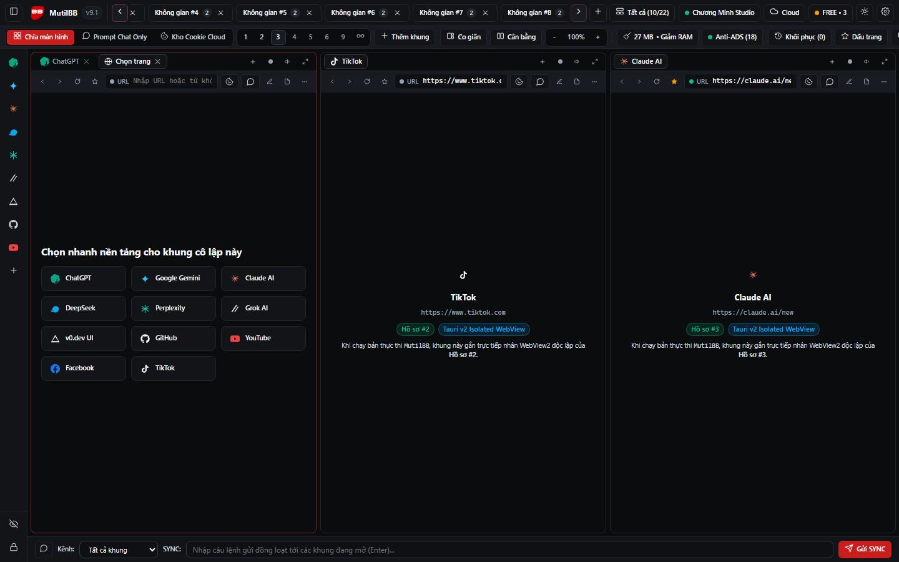
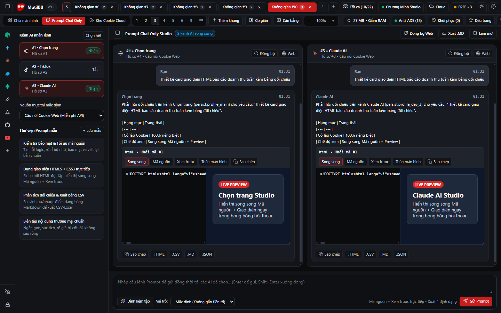
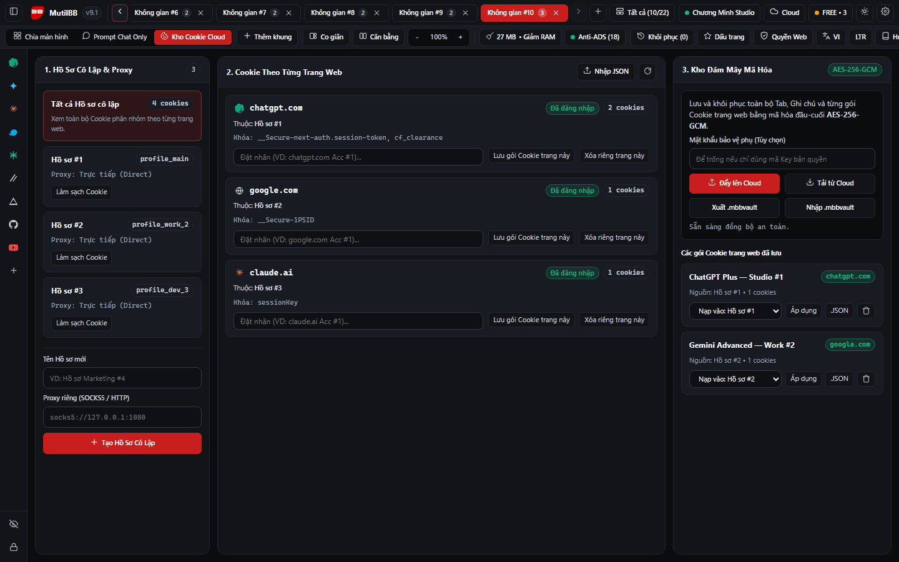
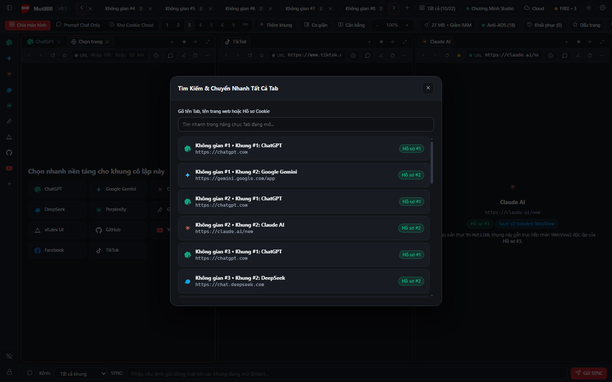

# MutilBB v9.1.0 Studio Edition — Trình Duyệt Chia Màn Hình Đa Phiên Siêu Nhẹ & Prompt Chat Only Studio (Tauri v2 + Rust)



**MutilBB v9.1.0 Studio Edition** bởi **Chương Minh Studio** được kiến trúc mới hoàn toàn trên nền tảng **Tauri v2 Native Multi-Webview + Rust** siêu nhẹ (bộ cài chỉ **2.44 MB**, giảm **>96%** so với kiến trúc Electron cũ), giúp bạn mở đồng thời hàng chục không gian làm việc, chia màn hình đa tài khoản AI (**ChatGPT, Google Gemini, Claude AI, DeepSeek, Perplexity, Grok, v0.dev**) và mạng xã hội với **thư mục Cookie + Proxy cô lập hoàn toàn theo từng Hồ sơ**, đồng bộ đám mây mã hóa **AES-256-GCM cho từng Cookie và từng trang web**.

---

## Tải Xuống Trực Tiếp Dạng Raw (`v9.1.0` — Windows 10 / 11 x64)

Nhấn trực tiếp vào các liên kết `Raw` bên dưới để tải ngay tệp thực thi đã ký số chuỗi chứng chỉ 2 tầng **`Chương Minh Studio`** kèm dấu thời gian quốc tế **DigiCert SHA256 RSA4096**:

| Gói cài đặt / Tệp tin | Dung lượng | Liên kết tải trực tiếp (`GitHub Raw`) | Ghi chú sử dụng |
| :--- | :---: | :--- | :--- |
| **Bộ cài chuẩn NSIS (`Setup.exe`)** | `2.44 MB` | [**⬇ Tải MutilBB-Setup-9.1.0-x64.exe**](https://raw.githubusercontent.com/chuongminhofficial/MutilBB/main/downloads/MutilBB-Setup-9.1.0-x64.exe) | **Khuyên dùng:** Tạo lối tắt Desktop/Start Menu & tự động nạp chứng chỉ UAC `Chương Minh Studio` khi cài quyền Admin |
| **Bản chạy ngay (`Portable.exe`)** | `6.53 MB` | [**⬇ Tải MutilBB-Portable-9.1.0-x64.exe**](https://raw.githubusercontent.com/chuongminhofficial/MutilBB/main/downloads/MutilBB-Portable-9.1.0-x64.exe) | Chạy trực tiếp 1 tệp duy nhất không cần cài đặt |
| **Gói Microsoft Store (`.msix`)** | `3.08 MB` | [**⬇ Tải MutilBB_9.1.0.0_x64.msix**](https://raw.githubusercontent.com/chuongminhofficial/MutilBB/main/downloads/MutilBB_9.1.0.0_x64.msix) | Gói cài đặt chuẩn AppX / Microsoft Store |
| **Bộ cài Doanh nghiệp (`.msi`)** | `3.35 MB` | [**⬇ Tải MutilBB-9.1.0-x64.msi**](https://raw.githubusercontent.com/chuongminhofficial/MutilBB/main/downloads/MutilBB-9.1.0-x64.msi) | Dành cho triển khai tự động Windows Installer (`/qn`) |
| **Kích hoạt UAC Admin 1 chạm** | `1.7 KB` | [**⬇ Cai-Chung-Chi-ChuongMinhStudio-Admin.bat**](https://raw.githubusercontent.com/chuongminhofficial/MutilBB/main/downloads/Cai-Chung-Chi-ChuongMinhStudio-Admin.bat) | Dành cho bản Portable: chạy quyền Admin 1 lần để hiển thị `Chương Minh Studio` trên UAC |
| **Chứng chỉ gốc (`Root CA`)** | `1.6 KB` | [**⬇ chuongminh-studio-root-ca.cer**](https://raw.githubusercontent.com/chuongminhofficial/MutilBB/main/downloads/chuongminh-studio-root-ca.cer) | `CN=Chương Minh Studio Root CA` (RSA-4096) |
| **Chứng chỉ ký số (`Publisher`)** | `1.6 KB` | [**⬇ chuongminh-studio-codesign.cer**](https://raw.githubusercontent.com/chuongminhofficial/MutilBB/main/downloads/chuongminh-studio-codesign.cer) | `CN=Chương Minh Studio` (`F0C3175D59BA069DC390AF6A6C6F145766C56357`) |
| **Bảng băm kiểm tra (`SHA256SUMS`)** | `0.6 KB` | [**⬇ SHA256SUMS.txt**](https://raw.githubusercontent.com/chuongminhofficial/MutilBB/main/downloads/SHA256SUMS.txt) | Mã kiểm tra toàn vẹn SHA-256 chính thức |

> Ngoài liên kết `Raw` tải trực tiếp ở trên, bạn cũng có thể tải tại mục [**GitHub Releases (Latest v9.1.0)**](https://github.com/chuongminhofficial/MutilBB/releases/latest).

---

## Hình Ảnh Các Chế Độ Nổi Bật Trên Bản `v9.1.0`

### 1. Chế độ `Prompt Chat Only Studio` — Song song `Mã nguồn | Xem trước` & Xuất 4 định dạng


### 2. Kho Đám Mây Mã Hóa `AES-256-GCM` Theo Từng Cookie & Từng Trang Web


### 3. Tìm Kiếm & Chuyển Nhanh Hàng Chục Tab Đang Mở (`Ctrl+Shift+A`)


---

## Các Nâng Cấp Trọng Tâm Ở Phiên Bản `v9.1.0`

- **Siêu nhẹ & Khởi động tức thì (Tauri v2 + Rust):** Loại bỏ hoàn toàn gánh nặng nhân Electron, thời gian mở cửa sổ `< 0.25 giây`, RAM điều khiển chỉ `~25 MB`, kèm nút **Giải phóng RAM ngủ đông 1 chạm** giữ nguyên 100% phiên Cookie đăng nhập.
- **Thanh Tab 2 tầng thông minh & Vuốt chuyển Tab mượt mà:**
  - Kéo chuột ngang có quán tính (**Drag-to-Swipe**) hoặc **lăn con lăn chuột dọc** trực tiếp trên thanh Tab không gian và thanh Tab con của từng khung.
  - Phím tắt **`Ctrl+Shift+A`** gõ lọc và nhảy tới bất kỳ Tab nào trong tích tắc.
- **Chia màn hình 8 bố cục & Điều khiển khung linh hoạt:**
  - Lưới `1`, `2`, `3`, `4`, `5`, `6`, `9` khung và **Vô hạn (`∞`)**, kéo vách ngăn 2 chiều + tâm chữ thập 4 khung.
  - **Tự động co giãn khung đang thao tác (`Ctrl+Shift+E`)**, **Cân bằng nhanh (`Ctrl+Shift+S`)**, **Thu gọn khung thành thanh dọc**, **Thu phóng đồng loạt (`Global Zoom`)**, và **Thanh lối tắt nhanh bên trái (`Quick-Launch Dock`)**.
- **Lưu Đám Mây Cho Từng Cookie & Từng Trang Web (`AES-256-GCM`):**
  - Tách riêng và đặt nhãn từng gói tài khoản theo đúng tên miền (`chatgpt.com`, `google.com`, `claude.ai`, `facebook.com`, ...), nạp/đổi tài khoản trên từng khung chỉ với 1 chạm, xuất/nhập tệp `.mbbvault` hoặc JSON Cookie.
- **Đầy đủ tiện ích chuyên nghiệp:**
  - Nút **Google OAuth 1 chạm** & **Mở khóa Cloudflare**, **3 màu viền đánh dấu trạng thái tài khoản**, **Bút dạ quang & Ghim chú thích trực tiếp trên khung (`Ctrl+G`)**, **Ghi chú thông minh 5 nhãn (`Ctrl+M`)**, **Khôi phục Tab vừa đóng kèm Cookie (`Ctrl+Shift+T`)**, **Dấu trang & Lịch sử (`Ctrl+B`)**, **Anti-ADS 5 lớp**, **Quyền trình duyệt & Thông báo MutilBB**, hỗ trợ **5 ngôn ngữ (`VI / EN / AR / JA / KO`) + `LTR / RTL`**.
- **Chứng chỉ số 2 tầng `Chương Minh Studio` chuẩn UAC Quản trị viên:**
  - Khi cài bằng `MutilBB-Setup-9.1.0-x64.exe` ở chế độ Quản trị viên (hoặc bấm nút **`Chương Minh Studio`** ngay trên góc phải ứng dụng), chuỗi chứng chỉ gốc `CN=Chương Minh Studio Root CA` được đăng ký vào kho máy giúp hộp thoại Windows UAC hiển thị đầy đủ **Nhà phát hành đã xác minh: Chương Minh Studio**.

---

## Kiểm Tra Toàn Vẹn Tệp Tin (SHA-256 Checksums)

| Tên tệp | SHA-256 |
| :--- | :--- |
| `MutilBB-Setup-9.1.0-x64.exe` | `3A787D4EFF0525121E56D29180A9D9249D9C903795CB3A0F59FE1B491CBAB29F` |
| `MutilBB-Portable-9.1.0-x64.exe` | `257E2A9BC532551A21AA125178C3BD998392553DCFD8B140E34B285C27213496` |
| `MutilBB_9.1.0.0_x64.msix` | `60261B5F7B8FA9D5CAAE88079630E6BB4C56E8D2AA5CB5AE930D70EE0F9274E8` |
| `MutilBB-9.1.0-x64.msi` | `4D17FF60093FE0D26AC66C92608675B6CC7D0810C7D264A051BA3397A08148BB` |
| `chuongminh-studio-root-ca.cer` | `E111786D702ADE737F70E6B8850DC1713370E321E00EDFA14C75B16F3B31B8B6` |
| `chuongminh-studio-codesign.cer` | `953D9A16BF219D2189CE3D340ADB1DAC438B3455F1A63A519014358E7B7B4FE0` |

```powershell
Get-FileHash .\MutilBB-Setup-9.1.0-x64.exe -Algorithm SHA256
```

## Hỗ Trợ & Báo Lỗi

- Kho lưu trữ công khai này chỉ phân phối các gói cài đặt chính thức đã ký số và tài liệu hướng dẫn. Toàn bộ mã nguồn thương mại được quản lý trong kho lưu trữ nội bộ riêng tư (**Chương Minh Studio**).
- Báo lỗi hoặc yêu cầu hỗ trợ tại mục [Issues](https://github.com/chuongminhofficial/MutilBB/issues).
